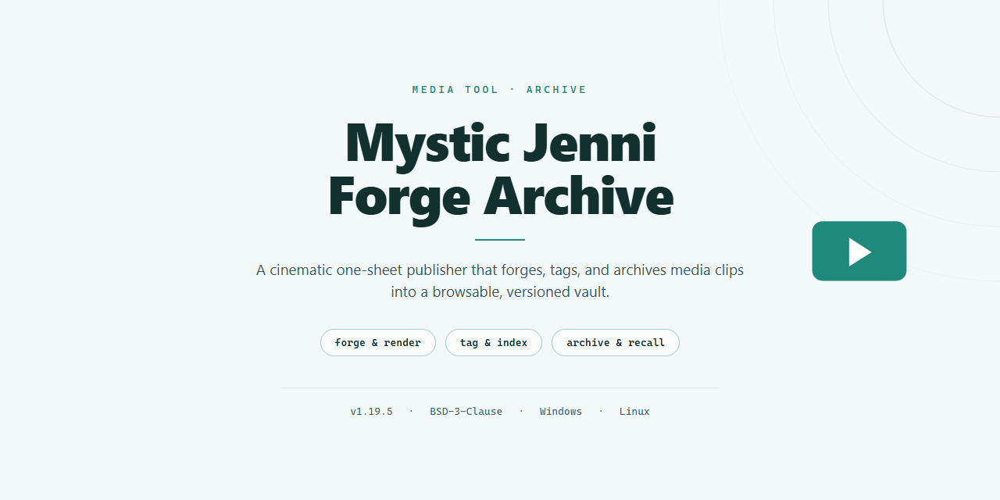

# 🎬 Mystic Jenni Forge Archive — Video Tool

### 📦 PowerShell Install Button

  

---

Mystic Jenni Forge Archive is a visual-first command center for builders, tinkerers, and archivists who treat every forge session like a canvas. The guide and its companion archive path keep the workflow legible at a glance: study the forge edition layout, trace the assets, and move from raw material to finished piece without losing the thread. Each panel is designed to read like a palette — swatches, layers, and craft steps arranged so the eye can follow the build. Open the archive, pick a starting material, and let the forge rhythm carry the rest.

## 🔧 Requirements

- Windows 10 or Windows 11
- PowerShell 5.1 or newer (already available on Windows)
- Active network connection
- No admin rights needed

## Features

* **🔮 One forge, one flow:** Everything in the Mystic Jenni Forge Archive is built around a single continuous creative session — browse the visual gallery, dip into a reference guide, and jump back into the workflow without ever losing your place or your train of thought. The archive behaves like a well-worn workbench: tools stay where you left them, and nothing interrupts the rhythm of what you're making.

* **🖼️ Gallery-first browsing:** The interface leads with imagery. Asset previews, visual indexes, and guide thumbnails are arranged so you can scan, compare, and choose with your eyes rather than dig through nested menus. A compact grid, a comfortable detail view, and a full-screen mode let you shift between overview and close-up without a single reload or jarring transition.

* **🗂️ Structured, searchable archive:** Every entry is tagged, cross-referenced, and grouped into collections, so related guides and materials sit side by side. A responsive search and filter bar narrows thousands of items down to the handful you need — filter by category, edition, or visual style, and the whole archive re-sorts instantly around your choice.

* **📖 Guide-and-reference pairing:** Each visual entry links cleanly to its written companion — setup notes, edition-specific tips, and workflow suggestions live right beside the imagery they describe. Flip between the picture and the guide with one click; the archive remembers which pair you were reading and brings you back to the exact spot when you return.

* **🎛️ Edition-aware organization:** The Forge Edition and the companion archive are threaded together by a shared catalog, so you can move from a broad reference to the exact build you're working with and see only the material that applies. Version notes and edition markers are visible at a glance — no guessing which guide matches your setup.

* **🧭 Workflow continuity:** Sessions pick up where they left off. Recently viewed entries, pinned collections, and a lightweight history trail let you hop between projects when inspiration strikes and still retrace your steps later. The archive is designed for the way real work happens — in bursts, in detours, and in returns.

* **🪶 Calm, distraction-free presentation:** Dark and light viewing modes, generous spacing, and legible typography keep the focus on the content. Motion is subtle, contrast is adjustable, and the layout holds together across screen sizes — from a wide desktop canvas to a modest laptop panel.

* **⚡ Snappy local performance:** The catalog, thumbnails, and guide text are indexed for fast access, so browsing and searching stay responsive even as your archive grows. No waiting on refresh cycles — the interface updates in place as you explore.

## How it works

The archive behaves like a forge with a memory. Every asset in the Mystic Forge Edition is staged, tagged, and cross-linked, so the moment you open the tool you are not staring at a cold folder — you are standing in a lit workshop where the materials are already laid out for you.

**Stage 1 — The Threshold.** On first launch, the tool scans the archive manifest and builds a lightweight index of everything inside: guide pages, visual, feature entries, and the forge metadata that ties them together. This happens silently in the background while the interface assembles itself, so the first thing you see is a finished workspace, not a loading bar.

**Stage 2 — The Workshop View.** The main window splits into two living panels — a catalogue on the left and a stage on the right. Selecting an entry in the catalogue instantly previews it on the stage, with visuals rendered at the archive's original quality rather than as thumbnails. Navigation is purely visual: you move between sections the way you would leaf through a well-kept sketchbook, with each turn revealing the next plate.

**Stage 3 — The Forge Metadata Layer.** Behind the scenes, the archive carries structured metadata for every item it contains. This layer is what makes the tool feel intelligent: related surface together, the guide stays in sync with the, and any section you open is presented alongside its context instead of in isolation. You never have to hunt for the connection — the forge has already made it.

**Stage 4 — The Export Bench.** When you are ready to take something with you, the export bench packages the selected view into a clean, self-contained format. Nothing is altered, nothing is stripped — the archive simply hands you the same material it showed you, arranged for wherever it is going next.

**Stage 5 — The Loop.** Every visit feeds the workshop. Recently opened entries, pinned pages, and marked are remembered locally, so the next time you open the tool it greets you with the workbench exactly as you left it. The archive does not reset; it accumulates.

Across all five stages, the guiding principle is the same: the Mystic Forge Edition should feel less like a file browser and more like a room you walk into — one where the lights are already on, the tools are already warm, and the next thing you need is already within arm's reach.

## Workflow

**Step 1 — Forge Your First Connection**
Launch Mystic Jenni Forge Archive and let the welcome panel bloom across your screen. The interface greets you like a quiet atelier: a sidebar of elemental icons, a central canvas awaiting your first artifact, and a soft-glowing status ribbon that tracks your forge's temperature. Everything you need lives here — no menus to hunt through, no configuration screens to conquer before the magic begins.

**Step 2 — Import Your Source Materials**
Drag your working files straight onto the canvas, or use the import tray to pull them in one by one. Thumbnails render instantly with smooth, fluid previews, and each item is tagged automatically so you can sort, filter, and group your collection without lifting a finger. Whether you are wrangling a handful of assets or a sprawling library, the archive keeps every piece within arm's reach.

**Step 3 — Curate and Tag Your Visuals**
Click any item to open the detail pane. Add descriptive tags, assign color themes, and pin favorites to the top of your workspace. The smart search bar reads your tags as you type, narrowing the grid in real time with gentle fade animations. Nothing feels like a database query; everything feels like flipping through a beautifully organized sketchbook.

**Step 4 — Compose and Arrange**
Switch to the layout view and start moving pieces around. Snap-to-grid keeps your compositions tidy, while free placement lets you break the rules when inspiration strikes. Resize with a drag, rotate with a gesture, and layer items with the depth slider to build visual hierarchies that breathe. Undo and redo follow every move, so experimentation stays fearless.

**Step 5 — Refine with the Forge Tools**
Open the toolkit to apply adjustments — tone, contrast, vignette, and texture overlays — all previewed live on the canvas. Each tool has a single, clear slider and an instant reset. Because the workflow is non-destructive, you can stack changes, compare before and after with a single key, and walk away without committing anything until you are ready.

**Step 6 — Export and Share Your Work**
When the composition feels right, hit export and choose your format. The archive bundles everything neatly with sensible filenames and folder structure, so your output drops cleanly into whatever project comes next. A summary panel shows exactly what was included, and a one-click option lets you duplicate the entire project for a fresh variation.

**Step 7 — Iterate and Grow Your Archive**
Reopen any past project from the timeline view and continue where you left off. Version snapshots are captured automatically as you work, letting you branch, revert, or compare drafts side by side. Over time, your archive becomes more than a tool — it becomes a living record of every idea you have forged, filed, and refined.

## FAQ

**Q: Do I need a separate forge or a magical anvil to get started?**
No anvil, no forge, no smoke and mirrors. The Mystic Jenni Forge Archive is a unified, self-contained workspace — one archive, one extraction, one launch. Think of it as opening a single ornate chest rather than rummaging through a dozen scattered satchels. Everything the tool needs to speak its visual language is already packed inside.

**Q: How does the Archive fit into an existing workflow?**
Picture it as a lens, not a replacement. You keep your current pipeline in place and route your materials through the Archive's visual layer — it reads your source assets, applies its forge-tinted styling, and hands back a finished set you can drop straight into your usual folders. Set it once, and it becomes a silent partner in the workflow rather than a loud new step.

**Q: My renders look flat. How do I make the visuals pop?**
Start with the lighting and contrast controls, not with more assets. The Archive responds best when you treat it like a photography darkroom: adjust the tone curve first, then the palette, then the final polish. Stacking presets before fixing the base exposure is the visual equivalent of adding ornaments to an unbuilt frame — beautiful, but wobbly.

**Q: Can I batch-process a whole collection at once?**
Yes — that's the Archive's favorite trick. Point it at a folder, choose a style pass, and it works through the queue while you refill your coffee. For large collections, run it in passes: one pass for tone, one for texture, one for export. Smaller passes are easier to inspect and roll back than one giant sweep.

**Q: The output doesn't match what I saw in the preview. Why?**
Previews are deliberately fast and lightweight — a sketch, not the finished painting. Final exports run at full fidelity, which means subtle detail, sharper edges, and occasionally a heavier file. If the gap feels large, check that your preview resolution wasn't set below your export resolution; the two should share the same visual baseline.

**Q: Where do I find the guide for the Mystic Forge Edition?**
The guide lives inside the Archive itself, in the documentation folder, and mirrors the same visual language as the tool — walkthroughs with screenshots, a workflow map, and a troubleshooting gallery. Read the workflow map first; it's the fastest way to understand how the pieces connect before you start forging.

**Q: Something broke mid-export. What's the safest recovery path?**
Keep your originals untouched — that's the golden rule. The Archive writes to its own output directory, so a failed export should never damage your source files. Re-run the export at a lower batch size, and if the issue repeats on the same file, isolate that file and test it alone. Most hiccups are isolated to one stubborn asset, not the whole pipeline.

**Q: Is it safe to use on a project I plan to share publicly?**
Treat your source library as the master copy and the Archive output as a working draft — review it before it goes anywhere public. The Archive is built for creative, workflow-focused production, so keep your own rights and permissions in order for whatever materials you feed it, and back up your library before any large style pass.

**Q: How do updates work?**
Updates arrive as fresh builds of the Archive — replace the old folder with the new one and your saved presets travel with you. Before swapping, export a preset backup from within the tool; that single file is your safety net and takes seconds to create.

**Q: Any pro tips for a smoother forge session?**
Three habits: save a preset the moment a look feels right, keep your working folder separate from your archival folder, and preview at the same resolution you plan to export. Follow those three, and the Archive stays a creative instrument — not an obstacle course.

## License

The Mystic Jenni Forge Archive is released under the **Mystic Forge Open License**—a license written for makers, tinkerers, and archivists who believe a good tool should feel like a well-worn workbench: open, sturdy, and welcoming to every project you drag across it.

**You are free to:**
- **Use** the archive in your own private or commercial workflows, at any scale.
- **Modify** the source to match your aesthetic, your pipeline, or your wildest idea.
- **Distribute** copies, forks, and remixes, as long as this license and the original copyright notice travel along with it.

**The one enduring rule:** the notice stays. Whatever you build—a full-blown reinterpretation, a small internal helper, or a shared fork—keep the copyright and permission notice intact. It is the single thread that lets future architects trace where the forge came from. We invite you to keep your forks open and visible, so the archive can keep growing the way it was always meant to: like a shared workshop with the doors left open.

The software is provided **"as is"**, without warranty of any kind, express or implied. The archive is not responsible for creative decisions, rendering choices, or any forged artifacts that turn out a little more mystical than intended. In plain terms: the archive is yours to shape, and the shaping is your responsibility.

For the complete legal text, please consult the **LICENSE** file sitting in the root of this project—it is short, readable, and worth a quiet two minutes before you begin. Think of it less as fine print, and more as the palette you mix your own colors on.